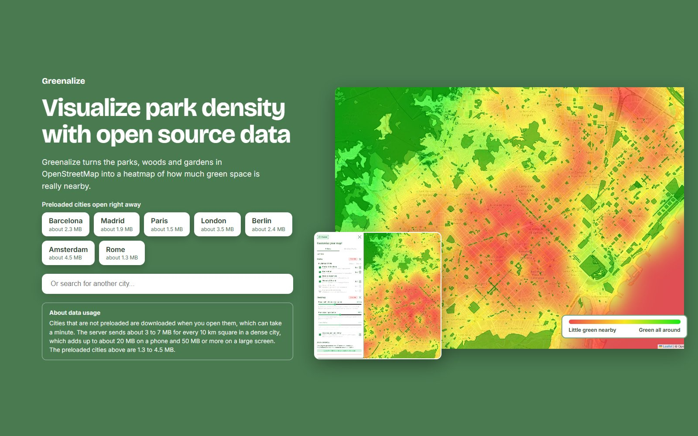
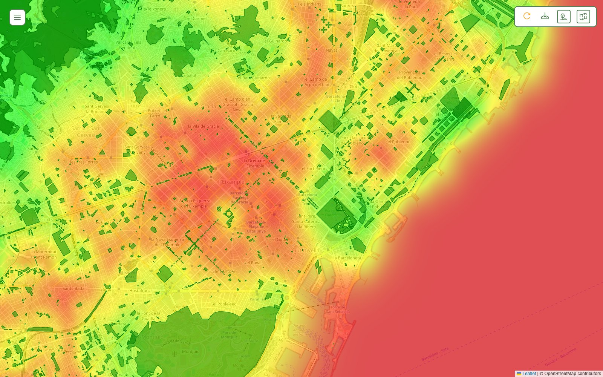
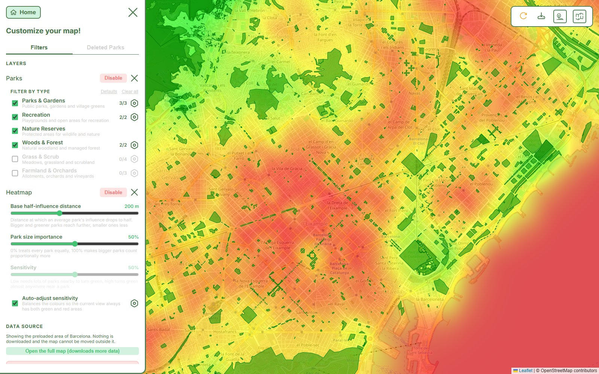

# Greenalize
### Description

Greenalize is a web application for exploring parks and green spaces on an interactive map. It features a heatmap visualization to highlight areas with strong or weak access to green spaces. Built with React, TypeScript, Vite, and Leaflet, Greenalize is fast, modern, and scaleable.

**Now available online at [https://greenalize.vercel.app/](https://greenalize.vercel.app/)**

## Features

- Interactive map for viewing parks  
- Heatmap layer to visualize park distribution  
- Optional park detail popups  
- Fast development with Vite  
- Type-safe codebase using TypeScript  
- Responsive layout for mobile and desktop  

## Screenshots

<br/>
<br/>


## Technology Stack

| Category | Technology |
|---------|------------|
| Frontend Framework | React |
| Bundler | Vite |
| Language | TypeScript |
| Map Library | Leaflet |

## Instructions

### Installation 

```bash
git clone https://github.com/BAD353/Greenalize.git

cd Greenalize

npm install
```

### Development 

To start the server, run
```bash
npm run dev
```

Open in the browser
```
http://localhost:5173
```

### Production 

```bash
npm run build
```

Preview the production build locally
```bash
npm run preview
```

### Other commands

| Command | What it does |
|---------|--------------|
| `npm run lint` | Lints the project with ESLint |
| `npm run export-city -- <id> [<id> ...]` | Downloads a city from Overpass and writes its preloaded file to `public/assets/data/cities/`. Ids come from `src/utils/preloadedCities.ts`, for example `npm run export-city -- paris berlin` |
| `npm run remerge-cities [-- <id> ...]` | Applies the current park merge rules to the preloaded files again, without downloading anything |
| `npm run capture-screenshots` | Takes the landing page and README screenshots |
| `npm run capture-city-screenshots [-- <id> ...]` | Takes the heatmap screenshots of the preloaded cities shown on the loading screen |

The screenshot commands need Google Chrome and the dev server running (`npm run dev`). They block live Overpass requests, so the screenshots only use the preloaded data.

### Preloaded cities

Preloaded cities open without downloading anything, at `/preloaded/<id>` (for example `/preloaded/barcelona`). To add one, add an entry to `src/utils/preloadedCities.ts`, then run `npm run export-city -- <id>`, `npm run capture-city-screenshots -- <id>` and set its `sizeMb` to the size of the new file.
